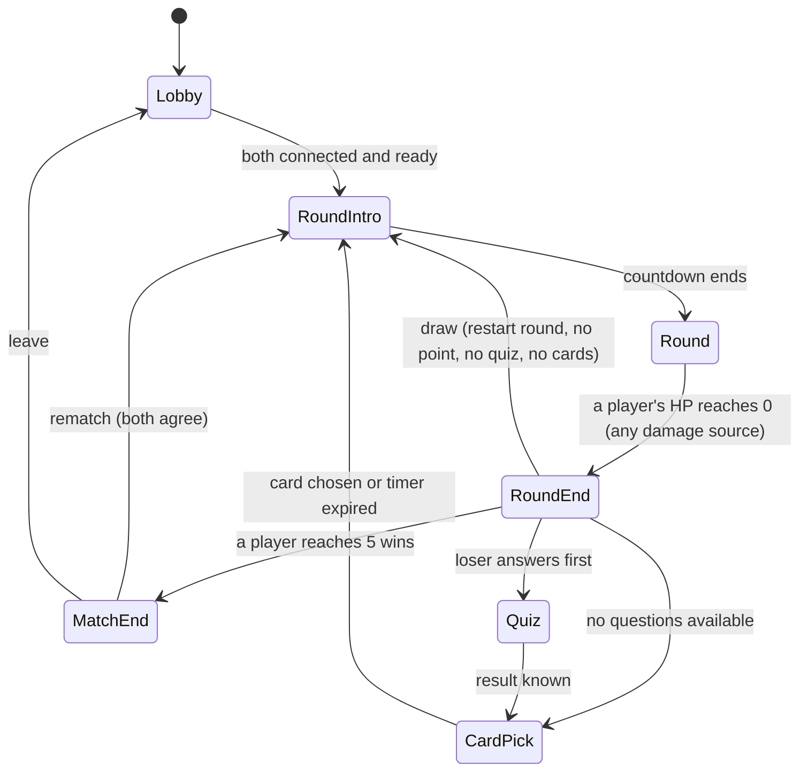

# RawAlanBattleRoyale - Design Document (Phase 0, revision 2)

**RawAlanBattleRoyale** (all art, names and card names are original). A 1v1 browser arena shooter inspired by the *mechanics* of ROUNDS: short duels on an open arena of floating platforms, the round loser answers a quiz and picks a card, the build snowballs. Source of truth for requirements: `instructions.txt`; newest owner decisions: the Decisions table in `PROGRESS.md`. Card list lives in `docs/CARDS.md`.

## Decisions already made (not up for debate)

- Vanilla JavaScript ES modules + HTML5 Canvas 2D. No framework, no build step; the repo is served as-is by GitHub Pages.
- PeerJS from a CDN (pinned version, 1.5.x), free public PeerJS broker for signalling, public STUN servers. No server of our own.
- Host-authoritative: host simulates at fixed 60 Hz, client sends inputs, host sends snapshots at 60 Hz (30 Hz when the link or the host machine is struggling), client interpolates a little in the past (adaptive, 40-150 ms) and shows its own movement, shots and blocks at once (prediction + local echo). Destruction, card picks, quiz results and round transitions are reliable events.
- The same simulation code runs in practice mode (local, dummy bot supplies inputs) and online (host). Practice mode therefore tests the real game.
- All tunables in `config.js`. One object per card in `cards.js`. One data file per map. One object per question in `questions.js`.
- Baselines: HP 100, bullet damage 20, fire rate 3 shots/s, magazine 5, reload 2.0 s, block cooldown 4 s, block window 0.3 s. (Base time-to-kill is 5 hits; a full magazine deals exactly 100, so a kill needs every shot of a magazine to land, or two magazines, or a shove out of the arena.)
- **Self-damage is on for everything:** your own bullets (after a 0.15 s owner-immunity that also ends at the bullet's first bounce) and your own explosions hurt you.
- **Open arena:** no walls, floor or ceiling around the screen; platforms float. Leaving by the bottom or the sides costs 30% of max HP and throws you back in; up is free.
- **Art:** pixel art, post-apocalyptic overgrown ruined city (style A, approved for everything including UI), see section 4.
- Name: RawAlanBattleRoyale everywhere (title, UI, PeerJS id prefix, docs).

---

## 1. Overview and match flow

Lobby, then repeated rounds. Each round is a duel on a random map. The round loser answers a quiz question, then picks a card. First to **5 round wins** takes the match.



Typical timings (all in `config.js`): intro countdown 2 s, round-end outro 1.5 s, quiz with NO time limit (owner decision), reveal 1.5 s, card pick up to 20 s.

## 2. Rules

- **Round start:** random map (never the same as the previous round), players at the map's two spawns, full HP, full magazine, block ready. The round waits in the **ready gate** (section 5c): nothing runs until every human screen has reported that it can show the round, then a 2.7 s "3-2-1-GO" that both players see in sync, with inputs, bullets, hazards, platforms and the round clock frozen.
- **Win a round:** the opponent's HP reaches 0, from any source: your bullets, explosions, out-of-bounds damage, or their own bullets and explosions (self-damage; if you die to your own shot the opponent wins the round).
- **Open arena and out-of-bounds (OOB):** there are no walls, floor or ceiling around the screen. The playfield is the 1280x720 logical field and platforms float inside it. When a player's centre crosses the **left, right or bottom** edge they take **15% of their max HP** (`config.oob.damagePct`, halved from 30% after the playtests; so Thick Skin pays more and Featherweight less) and are thrown back in (position clamped just inside the edge, velocity set toward the arena: 900 u/s up for the bottom, 700 u/s inward and 500 u/s up for the sides). After a throw-back the player is immune to further OOB damage for 2.0 s (`config.oob.immunity`). OOB damage ignores damage-reduction effects, cannot be blocked, can kill, and credits the last attacker within 3 s. **Up is free:** a player may rise above the screen. A soft ceiling zeroes upward speed at 500 u above the top so nobody can hide, and an **off-screen indicator** (a small arrow with the player's colour and distance, pinned to the top edge at their x) shows where a player above the screen is. Bullets leaving the screen are removed (64 u past the left, right and bottom edges, 600 u above the top so lobs and shots at someone above the screen still work), so bounces only happen on platforms, destructible blocks and card-spawned slabs.
- **Environment damage:** out-of-bounds damage and hazard damage (below) have no attacker (source -1 in the sim). They can kill; if one does, the round goes to the other player, and a same-tick double death is a draw like any other. Hazards never hit anyone twice within `config.hazards.rehit` (0.6 s), so nobody is melted instantly.
- **Round timer and sudden death (Phase 1, implemented):** a round lasts `config.round.timeLimit` = 45 s of live play (the clock stops during the end-of-round pause). Then **sudden death** starts: both players lose `config.round.suddenDeathDps` = 2 HP per second at 100 max HP (scaled by max HP, so 2% of it per second: a tank does not win just by having more HP) until someone dies. The player with less HP dies first; if both reach 0 on the same tick it is a draw (restart, no point, no quiz, no card). The HUD shows a small round clock next to the round number (amber under 10 s) and a "SUDDEN DEATH" banner, then a blinking plaque, when it starts. The clock resets every round. (Implementation numbers for out-of-bounds: invulnerability 1.5 s, and a returning player passes through terrain for 0.6 s so it cannot bonk a platform from below.)
- **Self-damage:** every bullet has an owner-immunity of 0.15 s that also ends at its first bounce; afterwards it hurts anyone, owner included. Explosions always hurt everyone in the radius. Block removes bullets but does not stop an explosion that goes off nearby.
- **Draw:** both players are dead when the round resolves (same tick, or a Parting Gift fuse that kills the winner, which delays resolution by its 0.5 s). The round restarts on a new map: no point, no quiz, no card, builds unchanged. If the second death happens on a later tick during the 1.5 s outro with no fuse pending, it is ignored (first death decides).
- **Card offer:** 5 distinct random cards, drawn without replacement, weighted by rarity (common 55, uncommon 35, rare 10; catch-up: 45/35/20 when 2 or more rounds behind). Cards at their `maxStacks` are excluded; if fewer than 5 remain, offer what exists. The loser chooses 1 (after the quiz, section 12). The winner gets nothing. No cards in round 1.
- **Quiz gate:** see section 12.
- **Match end:** at 5 wins. No quiz or card after the deciding round. Screen shows score and both builds. **Rematch:** both players press "Rematch"; the host resets scores and builds and starts a new match from RoundIntro (round 1). "Leave" returns both to the lobby.
- Players do not collide with each other (they pass through). Avoids body-blocking and keeps netcode simple.

## 3. Controls

| Input | Action |
|---|---|
| A / D | Move left / right |
| W or Space | Jump (hold for higher, tap for lower); wall-jump when touching the side of a solid; extra air jumps only with the Cloudstep card |
| Hold toward a wall in the air | Wall slide (walls are the sides of ruin pillars and platforms; the arena itself has no boundary walls) |
| Mouse | Aim (angle from your player to the cursor) |
| Left click (hold) | Shoot at the fire rate (hold = continuous) |
| Right click | Block (shield window, then cooldown). Context menu is suppressed |
| F2 | Toggle debug panel |
| Esc | Practice: pause menu. Online: leave-match menu (game keeps running) |
| 1-4 / 1-5 or mouse click | Answer quiz / pick card |

No manual reload in version 1 (auto-reload only, as in the brief).

## 4. Physics feel

**Feel:** snappy and readable on the ground (fast acceleration, quick stop, no ice-skating), with a slightly floaty apex and a faster fall so jumps read clearly. Not Newtonian-floaty: deaths should feel like the player's fault, and the 100 ms interpolation delay already adds softness online. Bullets are fast (1500 u/s) but visibly arc under gravity (500 u/s^2), so long shots need lead and aim above the target while close fights stay almost flat. Everything is tunable in `config.js`; the numbers below are a starting point to be tuned in Phase 1.

**Logical resolution: 1280x720 units (16:9)** for the simulation. The renderer draws the world to a **640x360 pixel canvas** (1 art pixel = 2 logical units; positions snap to the 2-unit grid, `imageSmoothingEnabled = false`), which is scaled x2 to 1280x720 and then uniformly (integer steps when possible, nearest-neighbour) to fit the window with letterboxing. Simulation uses logical units only; the render transform handles scale, and mouse coordinates are converted back through it. UI screens use the same 640x360 canvas and pixel font (or HTML with `image-rendering: pixelated`), so UI and world share one pixel grid.

**Art direction (owner decision, style A):** pixel art at Hyper Light Drifter level of pixelation, post-apocalyptic Fallout-like mood: muted, desaturated, darker palette, nature reclaiming ruins (overgrown skyscrapers, abandoned houses). No bright pink and no neon; accents are rust, moss and faded teal. Characters are small round shapes dressed as survivors, about 4-5% of the screen height (32 logical units = 16 art pixels = 4.4%), small relative to the world, ROUNDS-like proportions. Platforms are plain, low-texture and anonymous shapes in a few flat tones; the detail lives in the background layers, which never carry collision. Bullet and effect colours must stay readable against the muted background (light, slightly warmer than the scene, still not neon).

| Parameter | Value (config.js) | Notes / config key |
|---|---|---|
| Player hitbox | 30 x 30 (square AABB, drawn as a small round survivor, 4.2% of screen height) | `player.width/height`; the `size` card stat scales it (0.6 to 1.6) |
| Max run speed | 300 u/s | `move`: `base.moveSpeed`; about 10 body widths per second |
| Ground acceleration / friction | 2400 / 3000 u/s^2 | full speed in about 0.13 s, stops in about 0.1 s |
| Air acceleration / air drag | 1000 / 600 u/s^2 | air drag only when no input (ROUNDS-like: weaker air control, momentum carries) |
| Gravity (rising / falling) | 1900 / 2500 u/s^2 | fall multiplier 1.3 |
| Apex gravity multiplier | 0.75 when abs(vy) < 100 and jump held | slight hang time at the top |
| Terminal fall speed / speed limit | 950 u/s fall; no body ever moves faster than 1100 u/s | `move.maxSpeed` (stacked blasts on a light build reached 1700+ in the soak) |
| Jump velocity | 660 u/s | full jump height about 115 u (about 125 with the apex hang); tap about 30 u |
| Variable jump | releasing jump while rising multiplies vy by 0.45 | |
| Coyote time / jump buffer | 0.10 s / 0.12 s | |
| Stored jump charge | one charge, refilled on the ground or on a wall; walking or being knocked off a ledge keeps it | `move.ledgeJumpCharge`; a second air jump is not possible |
| Jump reach (measured, `node tests/jumpreach.mjs`) | same height: gap 215 u (comfortable 190); step up 60 u: gap 190; 90 u: 175; 115 u: 150; 125 u: 140; at most about 155 u up with a gap under 50 | map rule: gaps <= 190 u, steps up <= 120 u |
| Wall grip | only while airborne AND holding input into the wall AND 0.15 s after the last jump; no timer | `move.wallRegrab` |
| Wall glide | weak slide gravity 900 u/s^2 plus wall friction 8 /s: terminal slide speed 112 u/s, never above 160; rising along a wall uses 0.6 x gravity | `wallSlideAccel`, `wallScrub`, `wallSlideMax`, `wallRiseGravityMul` |
| Wall jump | kick 220 u/s away (sideways : up = 1 : 2.76), vy = -607 (0.92 x jump); allowed 0.10 s after wall contact; refills on contact; no steering lock | `wallJumpVx`, `wallJumpVyMul`, `wallCoyote`. Holding into the wall and tapping jump climbs it at about 200 u/s (about 68 u per hop) |
| Momentum carry | a shove / wall kick sets a 0.30 s carry timer: ground braking is 800 instead of 3000; speed above run speed decays at 1100 u/s^2 on the ground and 350 in the air | `carryTime`, `carryFriction`, `overspeedGround/Air`: a 260 u/s shove glides about 40 u |
| Corner forgiveness | box collider kept; ledge pop: a step or corner up to 10 u high is climbed instead of blocking you; head-bump nudge: a ceiling corner overlapping by up to 8 u is slid round | `ledgeStep`, `cornerNudge` |
| Bullet speed | 1500 u/s | `base.bulletSpeed` (limits 750-3750); swept collision in 4-unit substeps (25 u per tick, no tunnelling) |
| Bullet gravity / drop | 500 u/s^2 | drop = g x^2 / (2 v^2): 10 u at 300 range, 40 u at 600, 90 u at 900; hitting a target 800 u away needs 5.1 degrees of elevation (aim 72 u above) |
| Bullet radius / lifetime | 6 u / 3 s | Pepperpot sets the lifetime to 0.36 s (range 540 u) |
| Bullet spawn | player centre + 18 u along the aim | if the spawn point is inside terrain, impact happens immediately |
| Owner immunity | 0.15 s after firing, ends early at the bullet's first bounce | `combat.ownerImmunity`; afterwards the bullet hurts its owner too |
| Hit knockback | 260 u/s impulse along bullet direction, times (damage / 20), times attacker `knockback` and victim `knockbackTaken`; capped at 700 u/s | shoving an enemy off a platform or out of the screen is a damage source (see OOB) |
| Explosions | damage 100% within 32 u of the centre falling linearly to 40% at the radius; radial impulse 400 u/s times (damage / 20) times falloff; hits everyone including the owner | `combat.explosion*` |
| Out of bounds | 15% of max HP when the centre crosses the left, right or bottom edge; thrown back in (passes through terrain for 0.6 s, no air drag for 1.5 s); top is free | `config.oob.*` |
| Recoil | 0 (base); stat `recoil` stays for cards | ROUNDS only kicks the gun sprite |
| Block | RMB. Shield radius = body + 10 u for **0.3 s**; bullets touching it are destroyed (Return Policy reflects them); **cooldown 4 s counted from activation**; cannot shoot during the 0.3 s window; can move. Fires `onBlock` per destroyed bullet. Explosions are not stopped | `base.blockWindow/blockCooldown` |
| Reload | Starts automatically when the magazine hits 0; 2.0 s; magazine refills fully; cannot shoot while reloading | |
| Fire interval | 1/3 s; a full magazine is 5 shots in 1.33 s (4 intervals), then 2.0 s reload | |
| Destructible block HP | 50 default (set per block); bullet damage multiplier 1.0 vs blocks | `map.destructibles[].hp` |

*(Physics pass, `docs/PHYSICS.md` preset R: bullet arc, wall grip / glide / jump, momentum carry, corner forgiveness, stored jump charge, air control, no base recoil. Run speed, jump height, gravity shape, block, HP / damage / ammo are unchanged. The online client predicts its own movement with the same pure step, see section 5.)*

## 5. Netcode plan

**Topology:** one host peer, one client peer, PeerJS `DataConnection`. Host owns all game state. Serialisation is JSON in version 1 (target under 2 KB per snapshot, about 40 KB/s each way); binary packing is a later optimisation.

**Transport abstraction:** `Transport { send(type, payload, reliable), onMessage, onClose, close }` with two implementations: `PeerTransport` (PeerJS) and `LoopbackTransport` (BroadcastChannel between tabs of the same browser, no internet needed, with optional artificial latency / jitter / loss). The game code only knows `Transport`.

**Channels:** the PeerJS `DataConnection` (reliable, ordered) carries the handshake, events, intents and match views. Snapshots, inputs and pings go on a second `RTCDataChannel` created on the same `RTCPeerConnection` with `{ ordered: false, maxRetransmits: 0, negotiated: true, id: 11 }` (see section 5b); if it does not come up within 3 s, or the browser refuses it, everything uses the reliable one. Unreliable mode is the least battle-tested part, so this fallback is mandatory (and tested).

### Message types

| Name | Direction | Reliable | Contents |
|---|---|---|---|
| `hello` | C to H | yes | gameVersion, player name, reconnect token (if any) |
| `welcome` | H to C | yes | gameVersion, playerIndex, config hash, server time; or `reject {reason: full / version}` |
| `fullState` | H to C | yes | everything needed to resume: phase, scores, round, map id, builds, tick, destructible HP, quiz/offer state. Sent on join and on reconnect |
| `input` | C to H | no | seq, held-button bitmask (L, R, jump, shoot, block), edge bitmask since the previous frame, aim angle (quantised 16 bit), plus the last 3 frames repeated for redundancy |
| `snap` | H to C | no | see below |
| `ev` events | H to C | yes | `evSeq` (monotonic), `tick`, type + data: `roundStart`, `roundEnd`, `shot`, `hit`, `blocked`, `bounce`, `explosion`, `oob`, `fuse`, `blockDestroyed`, `matchEnd`, `rematchState` |
| `quizQuestion` | H to answerer (and read-only copy to other) | yes | question text, 4 answers in shuffled order (no deadline: the quiz has no time limit). **No correct index** |
| `quizAnswer` | answerer to H | yes | question token, picked index |
| `quizResult` | H to both | yes | picked, correct (bool), correctIndex (revealed now) |
| `cardOffer` | H to both | yes | 5 card ids, list of removed ids (empty or 3), deadline |
| `cardPick` | picker to H | yes | card id |
| `cardPicked` | H to both | yes | player index, card id (builds updated) |
| `rematch` | both to H | yes | boolean vote |
| `ready` | C to H | yes | `{ id }`: "my screen can show this round" (id of the gate, from the snapshot's `rg`; a stale id is ignored) |
| `ping` / `pong` | both | yes | timestamp echo |
| `leave` | both | yes | reason |

**Snapshot (`snap`):** `tick`, `seq`, `ack` (last client input seq the host applied), `phase`, per player `{x, y, vx, vy, aim, hp, maxHp, size, ammo, reloadLeft, blockLeft, blockCd, flags}` (flags: grounded, wallSlide, facing, alive, oobImmune; `y` may be negative: the client draws the off-screen indicator), all bullets `{id, owner, x, y, vx, vy, r, flags}` (flags: explosive, reflected, generation), card-spawned slabs `{id, owner, x, y, w, h, hp}`, and the HP of every *damaged* destructible `[id, hp]`. Positions rounded to 0.1 u. Because damaged-block HP is in every snapshot, a lost or late event never leaves the map out of sync. Moving platforms are **not** sent: their position is a pure function of the round tick (section 7).

**Interpolation:** client keeps about 1 s of snapshots. `renderTime = estimatedHostTime - delay`, where the delay is adaptive (section 5b: 1.5 snapshot intervals plus a margin for the measured jitter, clamped to 40-150 ms; it was a fixed 100 ms in the first version). Entities are matched by id and lerped between the two surrounding snapshots (angles wrap-aware). If the buffer runs dry, extrapolate with velocity for at most 100 ms, then hold. A position jump over 200 u (respawn) skips interpolation. Bullets fade in on first sight. Own aim indicator uses the local mouse immediately (cosmetic).

**Input handling:** client sends a frame at 60 Hz. Host applies the newest received frame each tick; edge bits (jump pressed, block pressed) are OR-ed across any frames received since the last tick so a quick tap is never lost. If no frame arrives, the previous held state repeats with no edges. The client sends an **aim angle**, not a cursor point, so the bullet goes in the direction the shooter saw.

**Events vs snapshots:** the two travel on different channels and may arrive in either order. Every event carries the host `tick` and a monotonic `evSeq`; events are processed in `evSeq` order. World/effect events (`hit`, `shot`, `blockDestroyed`, `bounce`, `roundEnd`) are held until `renderTick >= event.tick` so effects line up with the interpolated picture and "You lose" is never shown before the kill is visible. Flow/UI events (`roundStart`, quiz, card offer, match end) apply on arrival.

**Local prediction recommendation:** without prediction the client sees its own movement about `RTT + 100 ms` after pressing a key (about 180-250 ms on a typical house-to-house link). For a platformer that is noticeably sluggish. **Recommendation:** build Phase 2 without prediction, as decided, but write movement as a pure `stepPlayer(state, input, world, dt)` shared by everything, and playtest across two real connections. If movement feels laggy (expect it will on RTT above about 60 ms), add *light* prediction as "Phase 2b" behind `config.net.predictOwnMovement`: predict only the client's own movement (not shooting, damage or knockback); keep unacked inputs; on each snapshot rewind to the host's state for `ack` and replay the rest; snap if error exceeds 24 u, otherwise blend out over about 100 ms. Trade-off: about 100-150 lines and subtle bugs around moving platforms and knockback, in return for responsive controls; the host player is never affected.

**Ping:** `ping` every 1 s on the snapshot channel (so it measures the path the game really uses) with a timestamp; RTT is an EMA of the echo, jitter the smoothed deviation of it, loss comes from the snapshot sequence numbers. Shown in the debug panel and as a small corner indicator (section 5b).

**Disconnect / reconnect:**
- Dead-link detection: PeerJS `close`/`error` or no message for 5 s.
- Client lost: host **pauses** the simulation, shows "Opponent disconnected, waiting (30 s)". Client auto-retries the same room code with the same reconnect token (kept in `sessionStorage`); host answers with `fullState` and resumes. After 30 s the match is abandoned and the host returns to the lobby.
- Host's connection to the broker drops while the P2P link is alive: the game continues; the host calls `peer.reconnect()` in the background (only matters for new joins).
- Host lost: match ends for the client ("Host left"). No host migration.

**Room codes and invites:** 5 characters from an unambiguous alphabet (`ABCDEFGHJKMNPQRSTUVWXYZ23456789`, about 28 M combinations). The PeerJS id is `rawalanbr-<CODE>` (prefix keeps it unique on the shared public broker). Host creates `new Peer('rawalanbr-K7M4Q')`; on an "id taken" error it picks a new code. The client uses a random-id Peer and `connect('rawalanbr-K7M4Q')`. The host accepts one client and rejects others with `reject: full`. **Invite link:** `https://<user>.github.io/arena-game/#join=K7M4Q`; the page reads `location.hash`, pre-fills the code and offers a Join button. The hash is never sent to a server.

**Host timing:** the host loop uses an accumulator with `performance.now()`, at most 5 catch-up ticks, and is driven by a Web Worker timer so a host who alt-tabs does not freeze the match (browsers throttle timers in background tabs to about 1 Hz).

**Known limits and fallbacks:**

| Limit | Effect | Fallback options |
|---|---|---|
| Symmetric NAT / carrier-grade NAT / strict firewalls on **both** sides with no TURN | WebRTC connection cannot be established (a minority of home setups; rough order 5-15%, uncertain) | (1) clear error message plus "try a phone hotspot" tip; (2) add a free-tier TURN server (credentials would be public in the repo; rate-limited); (3) manual copy-paste signalling later |
| Public PeerJS broker (free, best-effort) may be down, slow or rate-limited | Cannot create or join a room | (1) retry with backoff and show status; (2) point to a self-hosted `peerjs-server` on a free tier (that is a server of ours, so only with the owner's OK); (3) manual signalling |
| Client and host have different cached versions of the site | Desync / odd behaviour | `gameVersion` in `hello`/`welcome`; mismatch shows "refresh the page" |
| Host is also a player | Host has zero latency; the client sees the opponent about RTT/2 + the interpolation delay (40-60 ms on a good link) late and its own movement, shots and shield at once | A hit is still the host's call: the client sees the damage RTT/2 + the interpolation delay after the bullet reaches the target; the client's bullets are checked against where the host player was on the client's screen (bounded lag compensation) |
| Host can cheat (authoritative) | Irrelevant for a game between friends | none needed |

**Implementation notes (Phase 2, src/net/):** as built; differences from the plan above are marked *(deviation)*.
- **Transport** (`net/transport.js`, `net/peer-transport.js`): `Transport { send(msg, reliable), onmessage, onclose, close(), open }` with PeerJS (`PeerNetwork`), an in-process loopback (`LoopbackNetwork`, virtual or real clock, latency / jitter / loss) and a BroadcastChannel loopback for two tabs (`BroadcastNetwork`, `?local=1`). PeerJS 1.5.4 is vendored in `vendor/` (MIT) instead of loaded from a CDN. The dual channel is built as planned (reliable + a second channel for snapshots / inputs with a 3 s fallback to the reliable one); *(deviation, fixed in the latency pass)* PeerJS `reliable:false` only gives an unordered channel that still retransmits, so the second channel is now an own `RTCDataChannel` with `maxRetransmits: 0` on the same peer connection (section 5b). Strings only (`serialization: 'raw'`).
- **Messages as implemented:** `hello {v,name,token}`, `welcome {v,you,hostName,token,rejoin,names}`, `reject {reason: full|version}`, `full {snap,mv,evSeq,names}`, `snap` (unreliable, every 2nd tick; compact arrays, see `net/snapshot.js`), `ev {n,list}` (reliable; every sim event of a tick, numbered), `in {f:[[seq,bits,aimQ] x3]}` (unreliable; newest first, edge bits for jump / shoot / block, aim quantised to 16 bits), `intent {i}` (answer / pick / continue / playAgain / hover), `mv {view}` (reliable; `matchView()` whenever it changes), `ping`/`pong`, `nack {error}`, `bye`. *(deviation)* The quiz / card-pick messages of the plan (`quizQuestion`, `quizResult`, `cardOffer`, `cardPick`, `cardPicked`, `rematch`) are folded into `intent` + `mv`: the match state machine is the source of truth and the client is shown `matchView()`, which hides the correct index and the explanation until the answer. There is no separate `leave`/`fullState` naming: `bye` and `full`.
- **Watcher:** both players receive the same `mv` (question, category, answers in the same order), so the non-loser sees the quiz, the reveal with the explanation, the face-up offer with removed cards struck out, the picker's hover (a throttled `hover` intent) and the card taken, read-only. The loser's `continue` advances both screens.
- **Host:** fixed 60 Hz accumulator (max 5 catch-up ticks) driven by a Web Worker timer (`net/tick-timer.js`) so a background tab keeps simulating; snapshots every tick or every 2nd (adaptive, section 5b); the host is player 0. **Client:** input frames at 60 Hz, snapshots interpolated an adaptive 40-150 ms behind with a min-delay clock estimate and up to 100 ms of extrapolation. **Own-movement prediction (Phase 2b, built with the physics pass, `config.net.predictOwnMovement`, on by default; `?predict=0` turns it off for a feel comparison).** The client runs the shared pure `stepMotion` (`sim/player.js`, the same code the host runs) on its own player every time it samples an input frame, and keeps the unacknowledged frames. The host simulates the client's frames **one per tick, in order** (frame n = tick n; a one-frame jitter cushion; a frame that is missing is repeated; piled-up frames are skipped; the client slows or speeds its input clock by at most 4% to keep the host's queue at the cushion) and echoes in every snapshot `ack` (the last frame simulated), `rt` (round tick after it), `ql` (queue length) and `q`, the client's full-precision movement state. On each snapshot the client rewinds to `q`, replays the frames after `ack` (moving platforms from `rt`, blocks from the newest snapshot) and compares with where it was: the difference fades out with a 70 ms time constant, a difference above 70 units (teleport, out of bounds launch, round restart) is applied at once. Only movement is predicted; damage, knockback, hazards, bullets and card effects arrive from the host and are blended in by the reconciliation. The state is sent unrounded because the step has hard thresholds (vy < 0, a timer reaching 0) and a rounded copy would replay differently. Measured on the virtual network (no prediction / prediction): first visible movement after a key press about 170 / 20 ms at 60 ms RTT, 225 / 12 ms at 100, 275 / 20 ms at 150; prediction error is exactly 0 on a clean link apart from teleports, see docs/TESTING.md.
- **Disconnects:** ping every 1 s, 5 s without any message = dead. The host pauses (no ticks) and keeps the room open 30 s; the client retries every 2 s with its token (kept in `sessionStorage`) and gets `full` back. After the grace period (or a `bye`) both return to the lobby with a message. A stranger without the token is refused (`full`).
### 5c. The ready gate (after the second playtest: "attacked before the guest could see")

**What the owner saw, and why.** A round used to go live the moment it was created, on the host / in the practice sim, while the screen that had to show it was not ready: (1) the animated scene of the new map is built in a worker (2-4 s, again for every map change) and the screen shows the previous picture or a dark gradient meanwhile; (2) the guest had connected but had not drawn its first frames, or was still fading the lobby away; (3) a tab that was just shown; (4) the map-name banner was a timed overlay (`performance.now()`) that sat on top of live play. The host (or the practice dummy) was already moving, shooting and taking damage in all of those moments.

**The gate (`sim/world.js`, phase `'ready'`).** Every round begins in the phase `ready`: the map is chosen and drawn, the players stand at their spawns, and nothing runs. `step()` only counts ticks and the wait: no input is read, no bullet, hazard or moving platform moves (`roundTick` stays 0), the round clock and sudden death have not started, nobody takes damage, bots are not asked for input. It is used for the first round of a match, after the quiz and card pick, after a draw, after a rematch and after a reconnect (resume gate). `state.gate` switches it on (practice and online sessions turn it on; the headless sim tests leave it off and rounds are live at once; `config.round.gate`).
- **Ready reports.** `state.ready = { id, got:[host, client], cd, waited, resume, back, forced }`. `id` identifies THIS gate (a counter): a ready report carries it, so a stale one from the previous round, or from before a reconnect, is ignored (`markReady`). A bot (`match.auto`) is ready at once. A human screen reports ready only when it can really show the round (`main.js gateWork`): the gate id has arrived with the state, at least 3 frames of it have been drawn, the tab is visible, and the scene of THIS map is built (`client/bgready.js`, below). Online the client's report is a small reliable message `ready { id }`; the host's own screen reports through `HostSession.localReady(id)`.
- **Countdown.** When every human is ready the sim counts down `config.round.countdown` (2.7 s: 3 for 0.9 s, 2, 1), frozen as well, then emits `roundGo` and the round is live. `cd` (seconds left, -1 = still waiting) is part of the snapshot (`rg`), timed by the host and sent as state, so both screens show the same number within a tick or two. `?countdown=0` (or `config.round.countdown = 0`) goes straight to GO.
- **What the screen shows.** The "ROUND n / MAP NAME" banner is part of the gate (it no longer covers live play), under it either the countdown digit or an honest line: `LOADING...` (+ "THE SCENE FOR THIS MAP IS STILL BUILDING") while this screen is not ready, `WAITING FOR TIDE TO LOAD... 7 S` while the other side is. A short `GO!` flashes over the first 0.6 s of play.
- **Time limits.** The host waits `config.round.readyTimeout` (20 s). Then, if the slow side is still connected and receiving state (a message within 3 s), the round starts anyway (`forced`; its background may be the previous picture); a side that is gone is the disconnect handling's business (the match pauses as before and nothing is forced). A screen also stops waiting for its own scene a little earlier (90% of that), so a scene that never finishes cannot hold the game. A hidden tab counts as not ready (no frames are drawn, visibility is checked) and so delays only the next round start; **nothing pauses a running round**, so hiding a tab cannot be used to stall a fight.
- **Reconnect.** When the opponent comes back in the middle of a round, `resumeGate` freezes the round exactly as it is (positions, HP, bullets, `roundTick`), opens a new gate (`resume`, `back: 'playing' | 'roundEnd'`) and counts a short `config.round.resumeCountdown` (1.5 s) once both are ready; the round then continues where it was. The first connection of a match uses the same gate for round 1.
- **The next map is known at round END** (`state.nextMapId`, decided in `step()` when the round ends, in `matchView.nextMap` for the guest): the map bag draws then instead of at the next round's start (`planNextMap`; `nextRound` / `newMatch` only take it), so every screen starts building the next scene during the roundEnd banner, the quiz and the card pick, and the wait is normally just the countdown. Still deterministic and decided by the host.
- **Scene readiness (`client/bgready.js`)** is the only code that asks `client/background.js`: `isBackgroundReady(id, variant)` ("a picture of that look can be shown right now, or it failed for good") and `prepareBackground(id, variant)` (build ahead, idempotent). If they were missing it would fall back to `getBackgroundStatus()`. Test hooks live here and nowhere in background.js: `?slowbg=4000` (`&slowbgonly=<scene id>`) pretends scenes need that long.
- **First load.** The title screen shows "Loading the game (the first scene is being built)..." until the first scene is ready (or `config.round.loadTimeout`, 15 s). A click on Practice / Create room / Join room (or an invite link) meanwhile is queued and runs when loading is done, so no hidden match can start. The test URLs (`autostart`, `screen`, `scenario`...) skip this and the gate unless `?gate=1`.

**Messages.** New: `ready` (client to host, reliable, `{ id }`). Changed: the snapshot carries `rg` while the phase is `ready` (`[id, countdown s, host ready, client ready, seconds waited, resume, countdown length]`), the match view carries `nextMap` and the phase `ready`. `gameVersion` 5.

### 5b. Latency pass (after the first real playtest over the internet)

The first playtest said "there was some latency". `tests/latency.mjs` measures, per thing a player perceives, the time from the cause to the picture on the screen (client drawing, 4 ms resolution, 16 trials, median; virtual network with jitter and loss; `landing a hit` includes the 0.27 s the bullet flies):

| What you perceive | 40 ms RTT before / after | 80 ms RTT | 150 ms RTT |
|---|---|---|---|
| your own movement (key to motion) | 24 / 8 | 12 / 12 | 16 / 16 |
| your own shot (click to YOUR bullet drawn) | 144 / 12 | 200 / 8 | 256 / 8 |
| your own shield (right click to shield drawn) | 204 / 4 | 216 / 4 | 276 / 8 |
| the opponent starts moving | 120 / 68 | 124 / 84 | 156 / 140 |
| the opponent's bullet hurts you (damage shown) | 116 / 60 | 148 / 76 | 176 / 140 |
| you hit a standing target 400 u away (damage shown) | 432 / 360 | 464 / 396 | 528 / 496 |
| the host simulates your jump / your shot | 64 / 76-80 | 84 / 92-96 | 124 / 124-128 |

(The last row is the one that got 12-16 ms worse: the host's input cushion now sits at one frame more on the quiet link; it is inside the noise of one tick and lag compensation covers it. The 150 ms column pays for the wider jitter margin: fewer dry buffers, see below.)

What changed, in order of how much it buys:

- **Local echo of your own actions** (`net/echo.js`). The client mirrors the host's few rules for "does this click do anything" (ammo, reload, fire interval, block cooldown) frame by frame, starting from every snapshot, which now carries the client's CURRENT shot stats and its exact timers (`sq`: timed and conditional card effects are included; full precision, because a frame is decided by `x <= 0`) and replaying its own frames after `ack`. When the model says "fire": the muzzle flash shows at once (the host's own `shot` event then arrives without a second flash), a plain shot (one bullet, no spread, no bounces, no card that changes bullets) draws a provisional bullet from the muzzle on the client's clock, and the recoil is part of the predicted movement. When the model says "block": the shield is drawn at once. The host stays the authority: it makes the bullet, the hit and the damage. The authoritative twin of a provisional bullet is hidden when it appears (one token per provisional bullet, first in first out, so there is exactly one bullet per shot on screen); a refused shot (the model was wrong) costs a bullet or a shield that does nothing for a moment and never changes state. There are no phantom hits: no hit, damage, hp or kill is ever predicted. `tests/net.test.mjs` checks that the echo fires on exactly the frames the host fires (15 of 15, 15 of 16 at 150 ms RTT with loss), that nothing is echoed while reloading, one block gives one shield.
- **Kickback recoil is predicted** (`net/predict.js`): the echo knows which frame fires, passes the velocity change as `kick`, the predictor applies it at the same place in the step as the host does (`sim/player.js fire` runs before `stepMotion`) and keeps it in the replay history. Mean correction while firing with Kickback: 0.80 units before, 0.00 after (`tests/predict.test.mjs`).
- **Adaptive interpolation delay** (`net/snapshot.js`). `delay = 1.5 x snapshot interval + max(2 x jitter, 0.75 x spread of the last ~90 packets) + 4 ms`, clamped to `config.net.interpMin..interpMax` (40..150 ms). It grows by at most 4 ms per snapshot and shrinks by at most 0.25 ms per snapshot (15 ms per second at 60 Hz): no visible time warp. Steady link: 40-60 ms (was a fixed 100). Link with +/-40 ms jitter and 4% loss: 113 ms and 35 dry-buffer frames in 10 s where the fixed 100 ms had 65.
- **Snapshots at 60 Hz** while the round trip is under about 220 ms, snapshot and input loss under about 8% and the host really runs 52+ ticks per second; otherwise 30 Hz (hysteresis, re-evaluated once a second; the host tells the client in every snapshot). Cost, measured on the virtual network with two bots: snapshot 420 bytes, host to client 29.7 kB/s at 60 Hz (63 messages/s) and 14.9 kB/s at 30 Hz, client to host 4.3 kB/s, host work 0.037 ms per tick at 60 Hz (0.020 at 30 Hz) of the 16.7 ms budget. Opponent view delay: 68 ms at 40 ms RTT (was 120).
- **A truly unreliable channel** (`net/peer-transport.js`). PeerJS 1.5 `reliable:false` is only unordered (the SCTP stream still retransmits, so one lost packet still delays the ones behind it). Both sides now create `pc.createDataChannel('rab-fast', { ordered: false, maxRetransmits: 0, negotiated: true, id: 11 })` on the same `RTCPeerConnection` (no renegotiation, no second PeerJS connection). Each side sends `U?` until it hears `U!`; only then do snapshots, inputs and pings use it; the reliable channel carries events, intents and match views and is the fallback (browser refuses, no answer within `unreliableTimeout`, channel closes). `tests/two-tab.mjs` (real PeerJS path) checks both ends: `ordered false, maxRetransmits 0, id 11, open, negotiated`, and that `netInfo().channel` says so.
- **Lag compensation, bounded** (`sim/bullet.js`, `net/host-session.js`). The host keeps the last 16 ticks of body positions in the state. A bullet of the CLIENT is tested against where the HOST player was `lagTicks` ago, `lagTicks = round(min(150 ms, clientViewDelay + ping/2) / 16.7)`; `clientViewDelay` is what the client reports in every input message (`vd`) and is clamped. Only client bullets are rewound, only the body hit test (the shield test, terrain, damage and everything about the host's own bullets use the present). Trade-off: the shooter gets what he saw; the host player can be hit a few frames "after" he ran behind cover (at most 150 ms; the standard rewind of every shooter game), and a client with a bad link gets the same rewind as one with a good link only up to that bound. Cheating: a client can lie about `vd`, but the clamp (150 ms, 9 ticks, always inside the 16-tick history) is also the most it could gain, and a rewind that does not match where the target really was never hits (it is a different position, not a bigger hitbox): `tests/net.test.mjs` checks the hit, the near-miss at 1 and 12 ticks, the clamp, that a negative or non-number claim is ignored and that only `lag[1]` is ever non-zero.
- **Host tick stability.** The simulation is driven by a Web Worker heartbeat, never by `requestAnimationFrame`, and catches up at most 5 ticks (`maxCatchUpTicks`), so drawing cannot delay it. The host measures its own tick rate once a second; below 52 ticks per second it drops to 30 Hz snapshots, draws every other frame to give the thread back to the simulation, and BOTH screens show "HOST IS RUNNING SLOW - THE GAME RUNS AT 41 OF 60 TICKS PER SECOND" (the client reads the rate from the snapshots, `hz`).
- **Network readout.** HUD: a small muted traffic-light dot (green-grey / amber / burnt orange, `net/quality.js`: ping, jitter and loss together) next to the ping. Debug panel (`\``): ping, jitter, loss in each direction (snapshot loss is counted from sequence numbers: lost OR too late to use), the channel the snapshots travel on, `direct` or `relayed` and the candidate types from `getStats()` (`probePath()` on the selected candidate pair, refreshed every 4 s), the host's tick rate, snapshot rate, interpolation delay (client) or lag compensation window (host), and traffic in kB/s each way.
- **Bug found on the way, in the old code:** a snapshot made before a newer match view could overtake it on the unordered channel and bring its old phase back (`snap.mvs <= mvVersion`). The client then sat in `roundEnd` while the host asked the quiz, and nobody could continue (found by a seeded bot match that froze for 8 virtual minutes). The phase of a snapshot is now only taken when its view version equals the one the client holds (`tests/net.test.mjs`, first test of the group).

**What is deliberately not predicted:** damage, death, hit effects, knockback taken, what the opponent does. A hit stays `RTT/2 + interpolation delay` after the bullet reaches the target; that is the floor of "the host decides" and is the price for one rule set and no cheating by the client.

**Connection diagnosis (light).** The lobby has a CONNECTION TEST button (`net/diagnose.js`): is WebRTC there, is the matchmaking server reachable (time to open a PeerJS id), does the network let STUN/UDP out (candidate gathering against the public STUN servers: no server-reflexive candidate means peer-to-peer traffic is blocked), and does the router hand out one public port for everything or a new one per destination (a "strict" NAT). The result is plain language plus a COPY RESULT button, e.g. "[ok] Matchmaking server: reachable (80 ms) / [FAIL] Peer-to-peer (STUN): no answer ... / Result: Peer-to-peer traffic (UDP) looks blocked by this network. Try a phone hotspot or your home network, or ask your friend to host." Failures while joining name the cause in the same words (room not found, matchmaking server unreachable, peer-to-peer blocked, host left). There is no relay (TURN): two networks that both block direct connections cannot play together, and the messages say what to do.

- **Rematch:** both players must press Play again (votes in `match.again`; a bot counts as agreed).
- **Cheats:** the debug panel's cheats (cards, heal, score, jump to screens, map, pause) work for the host only and act on the authoritative state; a client's panel is read-only.
- **Room codes:** 5 characters of `ABCDEFGHJKMNPQRSTUVWXYZ23456789`, PeerJS id `rawalan-CODE`; the invite link is `location.origin + location.pathname + '#join=CODE'` so it works under a sub-path.

## 6. Card system

**Data shape (`cards.js` exports an array; adding a card = adding one object):**

```js
{
  id: 'ricochet',                 // unique, stable
  name: 'Ricochet',
  rarity: 'common',               // common | uncommon | rare  (offer weight from config: 55 / 35 / 10)
  maxStacks: 2,                   // times one player may take it (default 1)
  desc: 'Bounces +4, damage -25%',
  mods: {                         // optional stat modifiers
    bounces: { add: 4 },
    damage:  { mul: 0.75 },       // mul is a factor; factors combine ADDITIVELY, see Stacking
  },
  hooks: {                        // optional, all host-side
    onBounce(ctx) { ctx.bullet.damage += ctx.bullet.launchDamage * 0.3; },
  },
}
```

**Implementation notes (local Phase 3):** card objects in `src/cards.js` use `description` (not `desc`) and add `lines` (the green/rust stat lines shown on the card) and `icon` (name of a pixel icon in `client/icons.js`). One extra stat, `fanAngle`, makes multi-pellet shots fan out evenly (Pepperpot); pellets are spawned by the core shot code, not by a hook. Hooks may use `ctx.reflect(bullet, {speedMul, damageMul})` (Return Policy) and `ctx.addTimed(mods, seconds)` (Scramble's timed modifiers). The caps (per-hit 40, per-trigger-pull 60, live bullets 60, impulse 700, burst 130, magazine budget 240) live in `config.caps` and are enforced in `sim/combat.js` / `sim/cardfx.js`. Base knockback is 260 per 20 damage, as in CARDS.md.

**Stat keys:** `damage`, `fireRate`, `magazine`, `reloadTime`, `bulletSpeed`, `bulletRadius`, `bulletGravity`, `bulletsPerShot`, `spread`, `bounces`, `knockback`, `maxHp`, `moveSpeed`, `jumpVelocity`, `size`, `blockCooldown`, `blockWindow`, plus the stats the extra cards need: `knockbackTaken` (base 1.0, scales incoming hit, blast and hazard shoves), `recoil` (base 0), `bulletLifetime` (base 3 s), `airJumps` (base 0, 0-3), `wallGlide` (base 1, 0 = hang on walls), `hazardTaken` (base 1, 0 = hazards do no damage) and `blockDamage` (base 1, 1-4, how hard your bullets hit crates, barrels and slabs).

**Stacking:** for every stat, `value = clamp( (base + sum of all add) * (1 + sum of (mul - 1) over all mul) , min, max )`. In words: percentages from different cards **add** (two cards with `mul: 2` give x3, not x4), so extreme cards cannot compound. Base values come from `config.js`; min/max from `config.statLimits` (the full table of caps is in `docs/CARDS.md`, "Global balance rules"). After the clamp two derived limits run: burst cap `fireRate * damage * bulletsPerShot <= 130` and magazine budget `magazine * bulletsPerShot * damage <= 240`. Damage hits are also capped at 40 per hit and 60 per trigger pull per target. Taking the same card twice applies its mods twice (up to `maxStacks`). Order of cards does not matter. Stats are recomputed only when the build or an active timed/conditional modifier changes.

**Hooks (run on the host / practice sim only, inside the fixed step; the client never runs them and only renders resulting state and events):**

| Hook | Fires when | Owner of the hook |
|---|---|---|
| `onShoot(ctx)` | right after a shot's bullets are created | shooter |
| `onBulletHit(ctx)` | a bullet is consumed by a player, a destructible or solid terrain (before damage is applied, so damage can be modified) | bullet owner |
| `onBounce(ctx)` | a bullet bounces off terrain | bullet owner |
| `onBlock(ctx)` | the owner's shield destroys a bullet (once per bullet) | blocker |
| `onDamaged(ctx)` | after the player has taken damage from any source (bullet, explosion, out-of-bounds, self-damage; `ctx.source` tells which) | damaged player |
| `onDealt(ctx)` | after the owner's attack hurt the opponent (`ctx.amount` = what was really dealt after the caps, `ctx.source` = bullet / explosion / card) | attacker |
| `onHazard(ctx)` | the owner touched a hazard (`ctx.hazardKind`), whether or not it did damage | touched player |
| `onRingOut(ctx)` | the opponent was thrown out of bounds within 3 s of the owner's hit (`config.oob.creditTicks`) | the attacker |
| `onBarrel(ctx)` | a barrel the owner destroyed is about to explode: `ctx.blast` { radius, damage, spare, owner } may be changed | the player who broke it |
| `onRoundEnd(ctx)` | the round was decided (`ctx.won`) | both players |
| `onTimer(ctx)` | a delayed effect of this card is due (`ctx.tag`, `ctx.data`) | the card that scheduled it |
| `onKill(ctx)` | after the player's bullet or effect kills the opponent, i.e. when the round is won (a kill by their own self-damage does not fire it) | killer |

`ctx` offers a small API only: `owner`, `target`, `bullet`, `amount`, `source`, `rng()` (seeded), `spawnBullet(opts)`, `heal(player, n)`, `explode(x, y, radius, damage)`, `applyImpulse(player, vx, vy)`, `removeCard()` (the calling card removes itself from the build), `schedule(delay, tag, data, {hold})` (a delayed effect stored as plain data in `state.timers`; when it is due the card's `onTimer` hook runs; used by the Parting Gift fuse, `hold` keeps the round open), `spawnSlab(opts)` (a temporary solid block, Bricklayer), `hurt(player, n)`, `fx(kind, data)` (a `cardFx` event for presentation), `state` (a per-player, per-card JSON object for cooldowns and counters). Besides hooks, cards can register **timed modifiers** (expire after n seconds) and **conditional modifiers** (active while a predicate such as "HP <= 40%" holds); both feed the same stat stack. Conditional modifiers are a card field `dynamic: { key(p, state) -> integer, mods(key) }` re-evaluated every tick (Cornered: HP, Limpet: clinging, Late Bloomer: seconds into the round). Bullets carry a small bag of flags the bullet step reads (`explosive`, `generation`, `shotId`, `launchDamage`, `reflected`). Hooks must go through this API so every effect also produces the matching events for the client.

**Build storage and sync:** each player has `build = ['ricochet', 'ricochet', 'heavy']` (ids, duplicates for stacks) plus the derived `stats`. Builds persist for the whole match and reset on rematch. Sync: `cardPicked` event on every pick, the full build in `fullState` (join/reconnect). Snapshots carry only the already-derived values the HUD needs (`maxHp`, ammo...), so the client never has to recompute stats; it uses card ids only for the build display.

## 7. Map format

One file per map, default export; all maps share the 1280x720 logical space. **The arena is open:** no map has a floor, wall or ceiling spanning the screen edges. Solids are floating platforms (and ruin pillars) inside the field, with at least 40 u of air between any slab and the left, right or bottom screen edge (lifts sit in that margin), so a player can fall or be shoved out. Out-of-bounds rules come from `config.oob`, not from the map. Backgrounds are decoration only and carry no collision.

```js
export default {
  id: 'overpass',
  name: 'The Overpass',
  spawns: [{ x: 240, y: 440 }, { x: 1040, y: 440 }],   // standing on the two outer platforms
  solids: [                                   // static floating platforms, plain rectangles
    { x: 160, y: 480, w: 240, h: 24 },
    { x: 880, y: 480, w: 240, h: 24 },
    { x: 520, y: 360, w: 240, h: 24 },
    { x: 560, y: 560, w: 160, h: 24 },
  ],
  destructibles: [                            // destroyed by bullets / explosions
    { id: 'd1', x: 420, y: 400, w: 32, h: 80, hp: 50 },
  ],
  platforms: [                                // moving, solid, carry riders
    { id: 'p1', w: 128, h: 16,
      path: [{ x: 300, y: 380 }, { x: 300, y: 200 }],
      speed: 60, pause: 0.5, mode: 'pingpong' },
  ],
  hazards: [                                  // things that hurt on contact (optional list, numbers in config.hazards)
    { id: 'h1', type: 'spikes', x: 200, y: 464, w: 36, h: 16, face: 'up' },       // rebar spikes: damage zone, not solid
    { id: 'h2', type: 'grate',  x: 500, y: 400, w: 70, h: 12, solid: true },      // ember grate: solid platform that burns
    { id: 'h3', type: 'saw', r: 14, speed: 90, pause: 0.3, mode: 'pingpong',      // saw blade; path points are its CENTRE
      path: [{ x: 585, y: 402 }, { x: 695, y: 402 }] },
  ],
  theme: { bg: 'overgrown-city', solid: '#4a4f45' }, // background id + platform tone; platforms stay plain
};
```

Map design rules for the open arena: platforms are plain and low-texture; leave bounce surfaces (undersides and sides of platforms) for bounce cards, but avoid corridors that focus bullets onto one spot; keep spawns on platforms; reachability rules from section 4 still apply; provide at least a few destructible blocks per map for Powder Keg (4 to 10); the density, headroom and fairness rules are listed under "The 30 maps" below.

- **Destructible blocks:** collide like solids until HP <= 0. A destructible with `kind: 'barrel'` is an **explosive drum** (HP `config.hazards.barrel.hp`, 30): when destroyed it explodes (radius 80, 40 damage, x2.5 against blocks) as environment damage, hurting players (the shooter too) and chaining into nearby barrels and crates. `explosion` and `blockBreak` events carry it to the client.
- **Hazards (`hazards[]`, Phase 1):** all hazard positions are data; hazard state is not stored anywhere except the round tick, so nothing needs syncing (a saw's position is a pure function of the tick, like a moving platform). Types: `spikes` (rect damage zone, `face` up/down gives the spike direction and shove, 15 damage, shove 520), `grate` (solid rect that damages whoever touches any side, 10 damage, shove 430), `saw` (circle of radius `r` along `path`/`speed`/`pause`/`mode`, 20 damage, shove 640 away from its centre). On contact a player takes the type's damage (environment damage), is shoved (velocity is set along the outward normal), and cannot be hit by any hazard again for 0.6 s. Events: `hazardHit {player, hazard, kind, x, y, nx, ny}` plus the usual `hit`. Rendering uses a consistent warm warning accent (rust-orange / ember, hazard stripes, sparks) so hazards read instantly against the muted plain platforms and the tan destructible crates; the debug hitbox view draws hazards in orange.
- **Hazard placement rules:** spawns, spawn islands and the main walking routes are hazard-free (tests assert no hazard or barrel near a spawn); hazards sit beside routes, on optional perches, under platforms (ceiling spikes) and in mid-air lanes (saws). Keep maps roughly mirrored for fairness; saw paths and moving platforms must not intersect terrain.
- **Destructible blocks (details):** collide like solids until HP <= 0. Bullets subtract their damage. Authoritative HP lives on the host. Snapshots carry the HP of damaged ones (so state self-heals); `blockDestroyed {id, tick}` is a reliable event used for the break effect. Crack stages are drawn from `hp / maxHp`. Destroyed blocks are restored at the next round start.
- **Moving platforms:** position is a **pure function of the round tick** and the path definition (ping-pong or loop, with pauses). Nothing is sent per frame; the client evaluates the same function at its render tick, so platforms never jitter or drift. Riders inherit the platform's per-tick displacement.
- **"Adding a map = adding one file":** without a build step the browser cannot list a directory, so honestly it is **one new file plus one registration line** (an `import` and an array entry) in `maps/index.js`. Alternative: a tiny optional script `tools/gen-map-index.mjs` regenerates `maps/index.js` from the folder (run manually or by a GitHub Action); cards and questions need no such step because they are single arrays in one file. Recommendation: start with the manual line (two lines of diff, zero tooling).
- Maps are validated at load (spawns inside the map, no overlapping solids at spawns, unique ids) with console warnings.

### The 30 maps and the rotation (Phase 4, re-done after the first playtests)

Each map is one data file in `src/maps/` plus its line in `maps/index.js`. The files use the small builder in `maps/build.js` (you write the LEFT half, the builder mirrors it for fairness, names the pieces and builds the two spawns; see `docs/ADDING-CONTENT.md`). Extra optional fields: `family` and `description` (one line), `background` + `backgroundVariant` (scene id from `client/background.js`; the 30 maps are spread over all 8 scene / variant looks, 3 or 4 each), `hazardStyle` (`rust` | `thorn` | `iron` | `brick`: only the hazard colours change) and `tunnels` (x ranges where the roof is deliberately low).

**Why they changed.** The first playtest said: platforms too close together (players bonked their heads and got wedged), too many obstacles in the middle of the lanes, falls too punishing, and "we need many more layouts". So every map, old and new, now follows these rules, all checked by `tests/maps.test.mjs` (the checks live in `tests/maplint.mjs`):

- **Headroom:** at least **120 u of free air above every standing surface** (slab, crate, ember grate), unless the map declares the x range a tunnel (then at least 80). Nothing is ever closer than 64 above something you can stand on. A raised route is a **staircase of side-by-side steps or solid blocks**, a wall to climb, or a lift; never thin platforms stacked 60-80 above each other.
- **Wide lanes:** no gap of 30-60 u between two facing sides that overlap vertically by 40 u or more (with Thick Skin a body is 48 wide); gaps are either under 30 (nobody enters) or 60+.
- **Sparse obstacles:** 0-3 hazard pieces (a mirrored pair counts 2), 4-10 destructible blocks, 3-20 slabs, and at least one moving platform or one hazard. Hazards live on the periphery (a pit, the far side of a perch), never in the straight jump arc between two platforms that can be jumped between; spawns, spawn floors and the main walking lines are hazard-free.
- **Fair first exchange:** the two spawns do not see each other along a flat line (terrain or cover in between), or are 760+ u apart (a flat shot has dropped 60+ by then).
- **Falls are survivable:** with the out-of-bounds damage halved (15% of max HP), a player thrown back out of the pit lands safely on something after exactly one fall in at least half of the cases on every map (31 positions tested). Wide-pit maps carry a slow raft, a lift or a low slab for that.
- Everything is reachable from both spawns with single jumps (steps up to 105, gaps up to 160-215 depending on the step, from the measured table in `tests/reach.mjs`), lifts or wall climbs; the test prints which surfaces need a wall climb (only the tops of Monolith's block and The Cross's post).

| Map (id) | Family | Backdrop | slabs / blocks / movers / hazards | Idea |
|---|---|---|---|---|
| Overgrown Downtown (`ruined-city`) | islands and lifts | Overgrown Downtown 0 | 9 / 8 / 3 / 1 | Two wide islands with a tram between them, a crate bridge to the centre, two perches, a saw below. |
| Waterfall Forest (`waterfall-forest`) | cliffs and lifts | Waterfall Forest 0 | 8 / 10 / 2 / 1 | Cliff walls to climb or lift up, a log bridge between the wall tops, a saw hanging below. |
| Old Plaza (`old-plaza`) | wide floors and a tram | Old Plaza 0 | 6 / 8 / 1 / 1 | Long floors and balconies, a short tram over the middle gap, a saw lane below. |
| Abandoned Suburb (`abandoned-suburb`) | small islands | Abandoned Suburb 0 | 13 / 10 / 2 / 3 | Small islands over a big pit: a short chain, a crate bridge to the middle, an edge lift to a perch. |
| Archipelago (`archipelago`) | island chain | Waterfall Forest 1 | 11 / 8 / 2 / 0 | A low chain and a high chain of islands in a wave; a drifting platform catches the fallen. |
| The Bowl (`the-bowl`) | bowl / valley | Old Plaza 1 | 10 / 7 / 1 / 0 | High rims, big steps down to a low floor, a skyway shuttle overhead. |
| Drifting Boxes (`drifting-boxes`) | bold shapes | Abandoned Suburb 1 | 7 / 8 / 0 / 1 | Big floating boxes climbing to a bigger one in the middle, open sky on all sides. |
| Brick Rows (`brick-rows`) | floating rows | Old Plaza 0 | 5 / 9 / 1 / 0 | Rows of crates float over the pit: run across them, or shoot them out from under someone. |
| Carousel (`carousel`) | lifts | Abandoned Suburb 0 | 7 / 6 / 1 / 0 | One platform rides a loop around a middle island, past the floors and the high perches. |
| Cloud Tops (`cloud-tops`) | island chain | Abandoned Suburb 0 | 11 / 6 / 1 / 0 | Clouds of every width zig-zag up to a wide one in the middle; nothing hangs over anything. |
| Crate Wall (`crate-wall`) | bold shapes | Abandoned Suburb 1 | 6 / 10 / 0 / 1 | A wall of crates fills the gap between two long floors; shoot it open or hop on top. |
| Flag Stairs (`flag-stairs`) | staircase | Abandoned Suburb 0 | 11 / 6 / 1 / 0 | Two big staircases face each other across a pit; a plank and a lift in the middle. |
| High Ground (`high-ground`) | asymmetric heights | Overgrown Downtown 1 | 4 / 9 / 2 / 0 | Spawn on a high cliff, fight on the low floor, ride the lift back up. |
| Lift Shaft (`lift-shaft`) | lifts | Waterfall Forest 0 | 4 / 8 / 2 / 0 | Two big lifts are the way up to a long deck; a small island sits low in the middle. |
| Lone Tower (`lone-tower`) | king of the hill | Waterfall Forest 1 | 5 / 8 / 2 / 0 | One tall tower, a lift on each side, a crate-covered top to fight over. |
| Long Bridge (`long-bridge`) | bridge | Old Plaza 1 | 6 / 10 / 2 / 0 | Solid ends, a bridge of crates over a deep pit: shoot it out and the sides are cut apart. |
| Lucky Row (`lucky-row`) | floating rows | Overgrown Downtown 1 | 9 / 7 / 1 / 0 | A low floor, three steps, a sky bridge of crates: shoot it and the middle plank is an island. |
| Monolith (`monolith`) | bold shapes | Overgrown Downtown 1 | 5 / 8 / 0 / 1 | One giant block in a wide pit: climb it, shoot over it, do not fall beside it. |
| Organ Pipes (`organ-pipes`) | pillars | Old Plaza 1 | 8 / 6 / 2 / 0 | Pillars of rising height on a long floor; hop top to top or climb the faces. |
| The Peak (`the-peak`) | staircase | Waterfall Forest 0 | 15 / 5 / 2 / 0 | A five-step mountain with a narrow apex; edge lifts lead to sniper perches. |
| Pipeworks (`pipeworks`) | pillars | Overgrown Downtown 0 | 9 / 10 / 1 / 0 | Pipes of three heights climb towards the middle; the valleys between are wide. |
| Shuttle Run (`shuttle-run`) | lifts | Old Plaza 0 | 5 / 4 / 2 / 0 | Ferries cross a wide pit to a middle island; a cover wall on each floor. |
| Stilt Tops (`stilt-tops`) | mushroom platforms | Waterfall Forest 1 | 11 / 6 / 1 / 0 | Tables on stems of different widths climb to a wide one in the middle; a sniper plank above. |
| The Cross (`the-cross`) | bold shapes | Abandoned Suburb 1 | 9 / 7 / 1 / 0 | A big plus floats in the pit: stairs to the arms, a wall to climb to the top of the post. |
| Trenches (`trenches`) | fortress | Old Plaza 1 | 7 / 8 / 0 / 1 | Two plateaus over a trench with cover, a barricade, and a plank walk above. |
| Twin Forts (`twin-forts`) | fortress | Overgrown Downtown 0 | 7 / 8 / 0 / 1 | Two forts with a front wall and a roof, a small island between them, a saw in the pit. |
| Two Spans (`two-spans`) | bridge | Abandoned Suburb 1 | 6 / 7 / 2 / 0 | A high span and a low span, tower lifts between them, crates you can shoot out of the high one. |
| Undercroft (`undercroft`) | low tunnels | Overgrown Downtown 1 | 5 / 6 / 2 / 0 | Open roofs with a low tunnel beneath each; a small island in the middle and a lift at each edge. |
| Underpass (`underpass`) | low tunnels | Old Plaza 0 | 4 / 6 / 2 / 0 | A long floor with a crawl-space tunnel under a roof deck; lifts at the tunnel mouths. |
| Ziggurat (`ziggurat`) | staircase | Overgrown Downtown 0 | 11 / 6 / 2 / 0 | A stepped pyramid over the pit, a lift and a sniper perch on each outer side. |

**Where the layouts come from.** Layout ideas only, all names and art are ours. From ROUNDS (Landfall): simple, bold, sparse arenas: a few big shapes, a central block, floating boxes, open air; bridges you can destroy; moving platforms and lifts as main routes; a variety of themes (the community "Overhaul Maps" pack lists 69 such maps with gimmicks such as destroyable bridges, rising or falling platforms and sky ferries: https://thunderstore.io/c/rounds/p/Ssencipe/Overhaul_Maps/; the 70+ map count is on https://store.steampowered.com/app/1557740/ROUNDS/). From Super Mario Bros: the end staircase (Flag Stairs, Ziggurat, The Peak), floating brick rows with gaps (Brick Rows, Lucky Row), pipes as pillars of different heights (Pipeworks, Organ Pipes), pits with stepping blocks (Cloud Tops, Archipelago), mushroom platforms of varying width (Stilt Tops), pyramids with a pit between (World 1-1: https://www.mariowiki.com/World_1-1_(Super_Mario_Bros.)), low ceilings with open sky above and lifts that rise and fall (World 1-2: https://www.mariowiki.com/World_1-2_(Super_Mario_Bros.): Undercroft, Underpass, the lift maps), and the "introduce, develop, twist" pacing of the level design guides (https://www.gamedeveloper.com/design/super-mario-bros-3-level-design-lessons-part-2).

**Rotation rule (practice and online identical, the host decides):** `sim/world.js drawMap` keeps a shuffled bag of the maps in `state.mapBag` (seeded by the match RNG, so it is plain state). A new map is drawn at every new round (after a card pick or a drawn round) and for a rematch; all maps appear before any repeats and a new shuffle never starts with the map just played. `mapLock` pins one map (the debug panel selector, `?map=id`, tests); without `rotate` the map never changes (the sim tests). The map id is already in every snapshot, so the client switches maps from the snapshot (its blocks and platforms come from the map data); the `roundStart` event carries the map id and the HUD shows "ROUND n - MAP NAME" for about three seconds. Destructible blocks reset every round. The test URLs (`autostart`, `screen`, `scenario`) pin the first map so pictures stay the same; `&rotate=1` turns the rotation back on there.

**Backdrop hand-over:** `client/background.js` builds the current scene first, then pre-builds the other maps' scenes one at a time as stills (`?prebuild=0` turns that off). When the map changes the new scene is used at once if its still exists; otherwise the previous scene's last frame stays on screen until the new one has a frame, and every change is a cross-fade of about 0.8 s (the first one fades from a dark dithered gradient, so the lobby never pops).

### Polish notes (Phase 5)

Canvas scale: integer from 2x up, quarter steps below (960 x 540 -> 1.5x, 800 x 450 -> 1.25x); the lobby and the Esc menu shrink with CSS zoom if the window is smaller than they are. Controls help: "ESC: HELP / MENU" in the corner, the Esc menu lists every control including the wall climb. Online, the client's own muzzle flash shows at once on a click (cosmetic; the host's own `shot` event for that shot is passed on silently so there is no double flash). Without WebRTC the lobby says so. Match-end card lists show the full descriptions (two lines each); the quiz explanation uses shorter lines with more air between them.

## 8. Testing tools

- **Practice dummy:** uses the exact same input path as a human (it emits `InputFrame`s), so it obeys ammo, reload, block and cooldowns. Modes selectable in the debug panel: *Idle target*, *Strafe* (walks back and forth, jumps every 1.5-3 s), *Aggro* (default: moves toward or away to keep range, jumps randomly, shoots when it has line of sight with 250 ms reaction delay and about 8 degrees of aim error, blocks when a bullet is within 150 u and heading at it, 30% of the time). Picks random cards when it loses. Practice runs the full round loop (quiz and cards included).
- **Debug panel (F2):** FPS, sim tick, entity counts; ping / RTT, snapshot rate, jitter, buffer depth; toggles for hitboxes, bullet paths and grid; **give card** to either player (dropdown + button); **pick map** and restart round; set HP / full heal; infinite ammo; no block cooldown; dummy mode; time scale (0.25x-2x, practice only); force quiz right / wrong / skip; jump to match end; simulated network latency / jitter / loss (online). In online mode cheats work for the host only and only with `?debug=1` in the URL; the info readouts are always available on both sides.
- **Two-tab local online test:**
  1. Serve the folder over HTTP (`python -m http.server 8000`; ES modules do not work from `file://`).
  2. Open `http://localhost:8000/?debug=1` in window A and press Host; note the code.
  3. Open the invite link (or the same page with `#join=CODE`) in window B and Join. Use `?local=1` on both to use the `LoopbackTransport` (works offline); without it the real PeerJS broker is used, which exercises the true path.
  4. Put the two windows **side by side**, not as background tabs (hidden tabs throttle timers and rAF and would stall the match).
  5. Add `?latency=80&jitter=20&loss=2` to simulate a real link.

## 9. File structure

```
arena-game/
  index.html                  page shell, canvas, PeerJS CDN script (pinned)
  PROGRESS.md                 decisions + current phase (required by brief)
  instructions.txt            the brief
  docs/DESIGN.md, CARDS.md    this document, card list
  css/style.css               menus, overlays, lobby, card/quiz screens
  src/
    main.js                   bootstrap, screen router, mode selection
    config.js                 ALL tunables (physics, combat, timings, net, weights)
    cards.js                  array of card objects
    questions.js              array of quiz question objects
    maps/
      index.js                registry: import each map + list
      foundry.js ...          one file per map
    sim/                      shared simulation: no DOM, no canvas, runs in Node too
      world.js                state container, fixed step orchestrator
      player.js               movement, jump, wall, shooting, reload, block
      bullet.js               bullet motion, swept collision, bounce
      collision.js            AABB vs solids/destructibles/platforms
      platforms.js            platform position as a function of tick
      cardfx.js               stat recompute + hook dispatch + ctx API
      match.js                round/match state machine, quiz gate, card offer
      rng.js                  seeded RNG
      input.js                InputFrame encode/decode
    net/
      transport.js            Transport interface
      peer-transport.js       PeerJS implementation (dual channel + fallback)
      loopback-transport.js   BroadcastChannel implementation + fake latency
      protocol.js             message type names, version, validation
      host-session.js         runs sim, applies inputs, sends snapshots/events
      guest-session.js        sends inputs, snapshot buffer, event queue
      room-code.js            code generation, invite link parse/build
      host-timer.js (+ worker)  throttle-proof tick driver
    practice/
      practice-session.js     local sim + dummy
      dummy-bot.js            dummy AI producing InputFrames
    client/
      render.js               canvas drawing, scaling, pixel snapping
      interpolation.js        snapshot buffer + render-time sampling
      fx.js                   particles, screen shake, damage numbers
      hud.js                  HP, ammo, cooldown rings, score
      keyboard-mouse.js       device input to InputFrame
      debug-panel.js          F2 panel
      ui/                     lobby.js, cardpick.js, quiz.js, matchend.js
  tools/gen-map-index.mjs     optional map index generator
```

Sessions share one interface (`HostSession`, `PracticeSession` own a sim; `GuestSession` owns an interpolation buffer) so the renderer and HUD read the same render-state shape in every mode.

## 10. Phase plan

| Phase | Scope | Done means |
|---|---|---|
| 0 | Research and direction | `CARDS.md` (25 cards, 10 marked for v1), this doc, mockups captured as images: gameplay in 2-3 style options, card-pick, lobby/room code, **quiz screen**. Owner feedback received |
| 1 | Local core | Move, jump, wall-jump, shoot, magazine/auto-reload, block, HP, self-damage (own bounced bullets), open arena with out-of-bounds damage and throw-back and the off-screen indicator, 1 floating-platform map, practice dummy, debug panel. 60 Hz fixed step with render interpolation; sim has no DOM dependency; numbers in `config.js`; hitbox view works; movement feels as in section 4 after tuning |
| 2 | Online | Host gets code + invite link; friend joins from a different network (tested on a phone hotspot or with a real friend); synced duel with interpolation; ping shown; disconnect shown and handled; loopback test mode works. **Exit check:** playtest movement lag; decide on Phase 2b prediction |
| 3 | Round/match loop, cards, quiz | Full loop in practice and online: first to 5, draws, rematch, rarity-weighted 5-card offer, the 10 v1 cards via data only, builds synced, **quiz gate with 3-of-5 removal**, `questions.js` with a few sample questions and the how-to-add note, empty list skips the quiz, reconnect restores full state |
| 4 | Maps | 4 maps (30 after the first playtests), destructible blocks and moving platforms synced and tested online, map rotation, map registry |
| 5 | Polish + deploy | Final art style, screen shake/particles, resize handling, error and status messages, README for adding cards/maps/questions, deployed on GitHub Pages and tested between the two houses; shareable link delivered |

The quiz lands in **Phase 3** because it only exists as part of the round loop and card pick; Phase 0 only needs its mockup and the data format.

## 11. Risks

- **NAT/broker failures** (section 5): cannot be fully removed without TURN or our own signalling. Test on real networks early in Phase 2, not at the end.
- **Client feel at 100+ ms:** mitigated by the Phase 2b prediction option.
- **Background throttling:** a hidden host tab stalls the match; worker timer plus a visible warning.
- **Stale cached files** on GitHub Pages: `gameVersion` check; consider a `?v=` cache-buster on module imports at deploy time.
- **PeerJS unreliable mode** may misbehave: the single-channel fallback is built in from the start.
- **Balance of extreme cards** (big numbers, hard caps, self-damage, shoves): tune using the debug panel's give-card tool and the caps in `config.statLimits`; run the pre-ship bot checks from `docs/CARDS.md`.
- **Open-arena edge cases:** repeated shoves, hiding above the screen, bullets leaving the screen too early. Covered by the 2 s OOB immunity, the soft ceiling and the top bullet margin; verify in Phase 1.
- **Scope:** dual-channel transport, reconnect and quiz are each small, but together are Phase 2/3 risks; reconnect is cut to "return to lobby" if Phase 2 runs long.

## 12. Between-rounds quiz

**Owner requirement:** between rounds a multiple-choice question with 4 answers; the person "has to pick the right one otherwise he loses the option to pick up 3 out of 5 cards randomly".

**Confirmed by the owner:** the round loser (the one who picks a card) answers a 4-option question. **Correct:** choose from all 5 offered cards. **Wrong:** 3 of the 5 offered cards are removed at random and the loser chooses between the remaining 2.

**Where in the flow:** `RoundEnd` outro, then `Quiz`, then reveal (shows the correct answer and, on a miss, the 3 cards being crossed out), then `CardPick`. Skipped after the deciding round of a match, after a draw (no quiz, no cards), and when no questions exist.

**No time limit (owner decision):** the quiz has no timer and there is no "timed out counts as wrong" rule; the answerer takes as long as they like (the only way out is answering, or leaving the match). Card pick keeps its own 20 s timer; on expiry a random remaining card is picked. During the quiz the winner sees the same question and answers read-only ("Opponent is answering..."), so waiting is not dead time (open question). If the answerer disconnects, the normal disconnect handling (section 5) applies.

**Networking:**
- The host picks the next question, shuffles the 4 answers per presentation (so position does not give it away), and remembers the permutation.
- `quizQuestion` carries text and the shuffled answers, **never the correct index**, so the answering client does not receive it before answering. When the host is the answerer the same code path runs locally.
- `quizAnswer {token, index}` goes to the host, which validates it against the real index and replies with `quizResult` (revealing the correct answer to both). Duplicate answers are ignored.
- The host then builds the offer (seeded RNG): picks 5 cards and, on a miss, removes 3 at random. `cardOffer` lists all 5 plus the removed ids so both screens can show them struck out.
- **Honest limit:** `questions.js` is a public file on GitHub Pages and the client downloads the whole game, so anyone who opens developer tools can read the answers. Protecting it would need a server. For a game between friends this is accepted.

**No repeats:** the host keeps a `usedQuestions` set per match; picks randomly among unused ones. If all are used, the set resets (excluding the last question). Reset on rematch.

**Empty or invalid list:** if `QUESTIONS` is empty, the quiz is skipped and the loser sees all 5 cards. Entries are validated at load (needs text, exactly 4 answers, `correct` an integer 0-3); invalid ones are skipped with a console warning.

**Data (`questions.js`, one object per question):**

```js
export const QUESTIONS = [
  { category: 'Geography',                          // optional
    q: 'What is the capital of Portugal?',
    answers: ['Porto', 'Lisbon', 'Faro', 'Braga'],
    correct: 1 },                                    // index into answers, 0-3
];
```

**How to add a question:** open `src/questions.js`, copy one object, change the text, write the 4 answers in any order, set `correct` to the position (starting at 0) of the right answer, save. Nothing else to change; only the host reads this file, clients get the text over the network.

**Implementation notes (local Phase 3, src/sim/match.js):**
- The match loop is a pure module with plain-data state in `state.match` and a shared `state.phase`: `ready | playing | roundEnd | quiz | quizReveal | cardPick | dummyTurn | matchEnd` (`ready` = the gate before every round, section 5c) (`dummyTurn` is the compact screen shown when the loser is the bot; it continues by itself after `config.match.dummyBeat` or on skip). The UI sends **intents** through `intent(state, player, {type})`: `answer {index}`, `pick {cardId}`, `continue`, `playAgain`. They are validated (right player, right phase, valid index / offered and not removed card, no second answer) and rejected with `{ok:false,error}`. `matchView(state)` is what a client may see: no correct index and no explanation until the question was answered, no card ids until the pick.
- The offer is built when the quiz starts (so the five face-down cards are real), with rarity weights 55/35/10 per slot (45/35/20 when the picker is 2+ rounds behind), tiers that run dry fall back to the next, and cards at `maxStacks` are not offered. Only Hair Trigger, Pinball and Thick Skin may be taken twice.
- Question choice uses the seeded RNG in the state (`state.rng`); `match.used` lists asked ids; when all are used the list restarts without repeating the last one. Answers are shuffled with the same RNG; `quiz.order` / `quiz.correctShown` are host-private data.
- Removed cards after a wrong answer: 3 random of the 5 (`config.match.wrongRemoves`). The dummy answers right with `config.match.dummyRightChance` (0.5) and takes a random remaining card.
- The screens are drawn on the 640x360 canvas by `client/screens.js` (mixed-case pixel font, same palette as the HUD). Keys: 1-4 answer (never A-D, those move you), 1-5 take a card, Enter/Space continue. Mouse hit-boxes are registered while drawing.

**Practice mode and debug:** the quiz runs in practice too; the debug panel can force right, wrong, or skip.

## 13. Open questions for the owner

Answered and removed since revision 1: quiz penalty (confirmed), the quiz has no time limit (confirmed), draws (restart, no point, no cards), art style and pixel strength (style A, 640x360 x2), game name (RawAlanBattleRoyale), friendly fire (self-damage on), fire rate versus reload (new baseline).

1. **Quiz winner's view:** should the winner watch the question read-only or just see "waiting"?
2. **Questions:** how many, which language(s), which difficulty and categories? Any rule that the same question may not appear twice in one match (we assume yes)?
3. **Round 1 and match end:** no card before round 1 and none after the deciding round (assumed). OK?
4. **Players:** names and colours (host/guest fixed colours?).
5. **Connection fallback:** are you OK adding a free-tier TURN server (public credentials in the repo) or a self-hosted signalling server if some friends cannot connect, or should we only show an error?
6. **Prediction:** happy to decide after the first real two-house playtest (Phase 2b)?
7. **Map choice:** random each round (assumed) or should the loser choose / players vote?
8. **GitHub account / repo name** for the Pages URL.
9. **Round timer / sudden death:** tank and sustain cards can make rounds long (proposal in `docs/CARDS.md`: after 45 s both players lose 2 HP/s). Wanted?
10. **Out-of-bounds tuning:** 30% max HP and a 2 s immunity after the throw-back are starting values. Is the damage alone enough, or should the throw-back also briefly empty the magazine or cost control?
